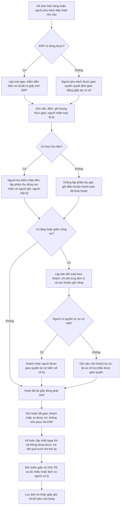

# Bổ sung quy trình kho: mất mạng, phiếu thu và ký đối soát nợ

> Bổ sung21/10/2026: xem [đối chiếu pháp lý và bộ chứng từ đề xuất](de-xuat-chung-tu-kho-theo-phap-ly-20261021.md). NĐ254/2026 và TT91/2026 có hiệu lực01/07/2026 đã thay căn cứ hóa đơn cũ; không dùng NĐ123/2020,NĐ70/2025,TT32/2025 như căn cứ hiện hành cho giao dịch mới. Mẫu ghép/nhân sự/luồngMISA cần đối chiếu như tài liệu bổ sung; chưa thay mẫu production hoặc coi quy chế này đã ban hành.

Ngày21/10/2026. **Quyết định nghiệp vụ và thiết kế cập nhật; chưa triển khai mã/schema/site.** Áp dụng ưu tiên so với nội dung cũ xung đột trong `thiet-ke-kho-giao-nhan-tiep-noi-0164.md` và sơ đồ đã trao đổi.

## 1. Quyết định chủ dự án trực tiếp chốt

1. Cửa hàng: một người dùng phần mềm có thể kiêm người thực giao nếu được phân công/cấp đủ quyền. Vệ tinh: người kho không cần tài khoản; đầu mối cửa hàng ghi nhận hệ thống.
2. **Bỏ điều kiện phải đợi phần mềm xác nhận xuất thành công mới cho xe rời.** Mất mạng lâu không bắt khách chờ.
3. Khi mất mạng, **cho phép lập giấy tay mới**, kể cả lượt chưa chuẩn bị/kiểm trên ERP; người phụ trách được giao quyền quyết định. Không tự suy tất cả nhân viên đều có quyền này hoặc tự đặt hạn mức tiền/số lượng.
4. Ảnh và giấy gốc xử lý sau, thiếu hồ sơ vẫn theo dõi việc tồn. Kế toán cửa hàng giữ gốc tập trung, vệ tinh chuyển về.
5. Khi thực thu tiền phải **lập phiếu thu cho người nộp/khách ký**. Tiền vẫn ghi nhận theo đúng company, nơi nhận, người giữ thực tế và lựa chọn phân bổ; ký nhận hàng không tự tạo khoản thu.
6. Khi có phát sinh tăng **hoặc** giảm công nợ, phải **in biên bản đối soát cho khách ký và lưu**. Có tăng và giảm bù nhau, cuối lượt bằng0 vẫn thuộc điều kiện, không chỉ xét chênh lệch số dư cuối.
7. **Một bản đối soát theo khách, trình bày riêng từng đơn vị và cọc/tiền chưa phân bổ**; không cấn chéo Company tự động.
8. Lái xe được khách chỉ định lấy hàng được ký nhận hàng theo quyết định trước. **Chỉ ký xác nhận công nợ nếu khách giao thêm quyền ký nợ riêng**; không suy quyền ký nợ từ quyền lấy hàng hoặc việc người đó nộp tiền.

Nguyên tắc mới: giao/thu thực tế và bằng chứng không bị mất vì ERP chưa ghi được. Mỗi nghiệp vụ còn phải ghi vào chứng từ native đúng một lần sau đối chiếu; không biến giấy dự phòng thành sổ kho/tiền song song lâu dài.

## 2. Hiện trạng nguồn đã kiểm

- `ban_quay.thu_tien` và `cashier_request` tạo Payment Entry, chống gửi lặp, ghi người giữ tiền theo cơ chế hiện có. `public/js/ux_thu_tien.js` đã mở bản in Phiếu thu chi cho từng PE trả về. Không kết luận hiện tại chưa có phiếu thu.
- `print_format/phieu_thu_chi` trên Payment Entry có chữ ký người nộp/thủ quỹ/người lập và các ô theo mẫu áp dụng; tiền ngân hàng có cách hiển thị riêng. Tái dùng mẫu đúng loại, không biến chuyển khoản thành thu tiền mặt hoặc cắt các ô mẫu chuẩn chỉ để ít người hơn.
- `print_format/bien_ban_doi_soat_cong_no` trên Customer đã có mẫu nhiều đơn vị, ký khách/người lập. Nguồn `ban_quay.doi_soat` tính Payment Ledger theo **ngày**, không snapshot của từng lượt; template ghi đến hết ngày. Chưa đủ để gọi là biên bản ký cố định tại thời điểm giao lúc giữa ngày.
- `quan_tri.ghi_nhan_xac_nhan` lưu mốc/số dư xác nhận hiện tại trên Customer và Comment; không thay cho lưu các bản giấy ký theo từng lượt. Không ghi đè bản cũ khi in lượt tiếp theo.
- `ban_quay.doi_soat` bản thân dùng SQL tổng hợp chưa có Company filter; phải rà lớp quyền/đường in và bổ sung giới hạn đúng khi tái dùng cho bản đối soát mới. Đây là nhận xét nguồn, chưa kết luận đã thử khai thác hoặc app đang lộ dữ liệu.
- Production0.16.4 chưa phải hệ thống offline-first. Mất internet có thể không mở/nhập/in được form mới; giấy tay có đánh số hoặc PDF đã tải là phương án vận hành dự phòng, không hứa trình duyệt tự làm việc offline hay tự đồng bộ khi chưa phát triển.

## 3. Luồng nhân sự cập nhật

Sơ đồ biểu diễn mốc công việc, không buộc lần nào cũng đi hết hai đường. Khi có mạng, nhập/ghi nhận trong lúc giao và thu, rồi cấp bộ giấy cho khách kiểm/ký; không cố đẩy mọi ghi sổ sang sau. Khi mất mạng, dùng giấy dự phòng và ghi hệ thống sau. Nếu chỉ một request lỗi hoặc mất phản hồi thì tra mã cũ: lỗi phía trình duyệt không chứng minh server chưa ghi.

Tự lấy: mốc thực nhận là giao và ký tại kho bởi khách/người được chỉ định, không dời mốc thực tế thành lúc nhân viên nhập bù. Gửi ship vẫn tách giao cho người chở và khách nhận cuối. Không thêm chờ chữ ký đối soát của khách tại kho khi người đang lấy chỉ là lái xe chưa có quyền ký nợ.

## 4. Giấy dự phòng và ghi nhận sau mất mạng

- Dùng giấy đã in sẵn hoặc biểu mẫu/sổ có đánh số kiểm soát theo điểm giao, quyển, tờ và loại nghiệp vụ. Lượt giấy mới vẫn ghi khách theo mã nếu có, tên/địa chỉ/liên hệ, đơn vị sở hữu, kho thực giao, mã/tên hàng, kg/bao, giá thỏa thuận, người giao/nhận, thời điểm thực tế và người quyết định cho giao.
- Giao hàng, thu tiền và đối soát nợ có số/tham chiếu riêng, cùng một mã bộ hồ sơ để truy về một lượt. Một tờ không được nhân đôi bằng việc nhân viên khác nhập lại; mã gốc phải được kiểm duy nhất trên hệ thống theo nghiệp vụ/chủ hàng, không chỉ theo user nhập.
- Người phụ trách được giao quyền quyết định lượt giấy mới trong phạm vi phân công. Danh sách nhân sự/phạm vi/hạn mức nếu có là cấu hình cần chốt khi triển khai; không tự bỏ toàn bộ kiểm quyền/duyệt hoặc biến mọi người thành người duyệt. Không yêu cầu một lần duyệt online bất khả thi mới được dùng giấy dự phòng.
- Kho kiểm tồn vật lý và ghi liên tục các lượt đã giao vào nhật ký giấy thống nhất tại điểm giao; không phát nhiều bản gốc cho cùng lượng. Các kênh khác phối hợp với đầu mối kho để tránh giao trùng. Đây là kiểm soát vận hành; khi mất mạng không thể hứa kiểm tồn/hạn mức toàn hệ thống theo thời gian thực.
- Không tự bật tồn âm, bỏ kiểm giá/hạn mức/kỳ khóa để nhập bù cho xong. Khi server chặn sau thực giao, giữ hồ sơ thực tế ở hàng chờ xử lý và người chịu trách nhiệm; không diễn giải là hàng vẫn ở kho hoặc tự xóa giấy/ghi ngày giả.
- Ghi riêng **thời điểm thực giao/thực thu** và **thời điểm nhập ERP**. Ngày hạch toán theo kỳ/quyền và kiểm native; kỳ đã khóa hoặc cần repost là ngoại lệ phải xử lý đúng thẩm quyền, không tự lùi ngày vượt khóa.
- Từng nghiệp vụ có kết quả riêng. Đã thu thật nhưng xuất chưa ghi được thì giữ tiền thu/cọc/chưa phân bổ theo thực tế, không xóa PE đã đúng chỉ để mọi bước cùng trông như chưa xảy ra. Hàng đã giao nhưng chưa thu thì không tạo PE bù giả.
- Hồ sơ chờ có mã giấy, người phụ trách, thực giao/thực thu, thời gian, ảnh/bản gốc, danh sách chứng từ đã đối chiếu và vướng mắc. Nếu chưa tạo được DN/PE thì hồ sơ vẫn phải được lưu/hiển thị để xử lý; không chỉ gắn một ô lên chứng từ chưa tồn tại. Khi build chọn nơi lưu hồ sơ có lifecycle thật, tái dùng tối đa entity native; không tạo bảng Nhiệm vụ/sổ tồn/công nợ trùng.
- Ghi nhận bổ sung không đồng nghĩa ghi nghiệp vụ lần hai: tra PE/DN đã có, khớp đúng nội dung trước liên kết. Nếu khác lượng/tiền/nguồn thì giữ ngoại lệ, không chọn đại chứng từ có cùng tổng tiền.

## 5. Phiếu thu và bản đối soát cho khách ký

### 5.1 Bộ giấy theo phát sinh

| Phát sinh thực tế | Giấy cho khách/người liên quan ký | Tác động ERP |
|---|---|---|
| Nhận hàng, chưa trả tiền | Phiếu giao nhận; biên bản đối soát nếu tăng nợ | DN/SI theo thực giao, không PE giả |
| Nhận hàng và trả tiền | Phiếu giao nhận + phiếu thu + biên bản đối soát có tăng/giảm, kể cả nợ cuối0 | DN và PE đúng nghiệp vụ; không ghi thu lần nữa từ bản ký |
| Chỉ trả nợ cũ | Phiếu thu + biên bản đối soát giảm nợ | PE/phân bổ đúng lựa chọn, không DN |
| Nộp cọc/tiền chưa phân bổ | Phiếu thu; bản đối soát trình bày khoản đã nhận/cọc/tiền chưa phân bổ riêng | Không tự cấn hóa đơn cũ hoặc gọi tiền chưa phân bổ là đã trả hết nợ hóa đơn |
| Trả hàng/hoàn tiền/giảm nợ | Phiếu nhận trả, chứng từ chi/hoàn hoặc giảm nợ đúng sự kiện và bản đối soát cập nhật | Không dùng phiếu thu cho khoản chi ra; không dùng biên bản ký để tự ghi bút toán |
| Bàn giao tiền nội bộ giữa nhân viên | Hồ sơ bàn giao tiền theo luồng quỹ đang có | Không thêm PE thu khách hoặc giảm nợ khách lần nữa |

Tiền mặt: người thu kiểm đếm và người nộp ký đúng số thực nhận. Chuyển khoản: chỉ ghi nhận đã thu khi xác minh tiền thực vào đúng tài khoản/tuyến, dùng chứng từ phù hợp; thông báo/ảnh chuyển của khách chưa được xác minh ghi là chờ xác minh, không tự tạo thu tiền mặt. Người nộp có thể là lái xe, ghi đúng người nộp; việc ký phiếu thu không tự trao quyền xác nhận toàn bộ nợ khách.

### 5.2 Nội dung biên bản đối soát mới

Một bản theo khách, có mã phiên bản/mốc đối chiếu và chi tiết từng Company; người lập phải có quyền đọc đủ phần đưa lên bản. Người chỉ có quyền một Company không được nhận bản toàn khách qua file, print hoặc API; bản một phần phải ghi rõ phạm vi, không đánh dấu đã đối soát toàn khách.

Hiển thị số trước lượt, các chứng từ phát sinh tăng/giảm thuộc lượt, số sau lượt; tách phần đã ghi sổ và phần còn chờ. Giữ cọc theo nguồn/đơn, tiền chưa phân bổ riêng. Phải chốt định nghĩa từng cột theo nguồn PLE/open invoices/funds và luồng thu hộ khi build; không lấy tổng hóa đơn dư dương trên đầu đơn làm số nợ ròng, không trừ cọc hai lần nếu khoản đó đã nằm trong số ròng.

Không dùng số liệu động theo cả ngày rồi in lại với ngày cũ như bản khách từng ký. Lưu snapshot các số đã ký, phạm vi Company, mốc chốt, danh sách chứng từ/mã giấy, người lập/người ký/căn cứ ký nợ, phiên bản và ảnh ký bất biến. Giao dịch đến sau, hủy hoặc nhập lùi ngày không sửa snapshot cũ; cấp bản bổ sung/đối chiếu mới khi cần.

### 5.3 Khi mất mạng hoặc thiếu người có quyền ký nợ

Có thể dùng số dư ở mốc đối chiếu gần nhất + phát sinh giấy đang biết để lập bản **tạm đối soát**; ghi rõ mốc dữ liệu, khoản chưa ghi sổ/chưa xác minh và phạm vi, không ghi là số dư hiện tại đã khớp đầy đủ. Nếu không có số dư đáng tin cậy thì chỉ xác nhận hàng/tiền/phát sinh của lượt này, phần số dư để chờ đối chiếu, không điền0 hoặc đoán để lấy chữ ký.

Sau có mạng, so với sổ và các giao dịch kênh khác; nếu lệch thì lập bản cập nhật và xin khách/người được quyền xác nhận, không sửa số trên ảnh/bản đã ký. Đây là hạn chế dữ liệu khi mất mạng, không phải thêm điều kiện giữ khách tại kho.

Lái xe không có quyền ký nợ chỉ ký hàng và khoản tiền mình thực nộp. Bản đối soát nợ chuyển khách/người có quyền ký sau và theo dõi Chờ ký; không tự đặt tên/chữ ký đại diện hoặc đánh dấu đã xác nhận nợ. Kênh gửi/thu hồi chữ ký do doanh nghiệp phân công; thiết kế không tự gửi email/tin nhắn cho khách.

## 6. Quyền, trách nhiệm và lưu trữ

Vai trò quyết định giao bằng giấy, người thực giao, người thực thu/giữ tiền, người nhập bù và người ký nợ là các dấu riêng. Một người có thể kiêm theo quyền được giao, nhưng nhập bù không biến mình thành người thực thu. Nếu người thu ở vệ tinh không có user ERP, phải xác định người giữ tiền thực tế và cơ chế bàn giao/ánh xạ vào quản lý quỹ khi triển khai; không tự gán tiền cho user nhập tại cửa hàng.

Ảnh/giấy gốc của phiếu thu, giao nhận và biên bản nợ gắn đúng loại chứng từ/hồ sơ. Người phụ trách kho chỉ xem phần cần thiết, không mặc nhiên thấy toàn bộ tiền/nợ liên Company. Giữ private File, lịch sử thay bằng chứng và số giấy gốc; kế toán cửa hàng ghi đã nhận giấy/vị trí khi thực có trong tay. Chưa có ảnh/gốc/chữ ký nợ không xóa giao/thu đã xảy ra.

## 7. Tác động hệ thống

Giao/thu bằng giấy ghi sự kiện thực tế, chưa phải DN/PE đã ghi sổ. Chỉ controller native ghi SLE/GL/PLE/SI/PE khi đối chiếu và xác nhận sau; không tạo ledger thứ hai, không tự tăng/giảm nợ từ in/ký/lưu/đối chiếu giấy. Theo dõi số giao thực tế chờ ghi sổ riêng để quản trị nhìn thấy chênh thời gian, không trình bày số tồn ERP chưa cập nhật là tồn vật lý chắc chắn có thể bán.

Tiền thu và ký đối soát là hai việc khác nhau: thu làm thay đổi tiền/phân bổ theo service; ký xác nhận là bằng chứng số đã thống nhất. Dùng cùng cửa thao tác và một lần in bộ giấy theo điều kiện để giảm đi lại, nhưng giữ token và kết quả riêng từng nghiệp vụ, không gom thành thao tác thu tự động lúc giao.

## 8. Ca kiểm bổ sung đề xuất — chưa chạy

- OFF01: mất mạng sau khi có phiếu chuẩn bị; giao thực tế, giấy có số, khách được rời; về mạng ghi đúng DN/không lần xuất thứ hai.
- OFF02: mất mạng trước lập đơn, người được giao quyền lập giấy tay mới; nhập sau truy được giấy/chủ hàng/kho/người quyết định, chưa được quyền không tự duyệt.
- OFF03: ERP đã commit nhưng mất phản hồi; hai user nhập cùng giấy/mã bộ: chỉ một chứng từ tương ứng mỗi nghiệp vụ, không dùng token theo user làm khóa chống trùng duy nhất.
- OFF04: nhập bù bị chặn bởi tồn/hạn mức/giá/kỳ khóa: giữ hồ sơ đã giao/chờ xử lý, không giả tồn âm hoặc xóa sự kiện thực tế.
- OFF05: người thu khác user nhập, thu ở vệ tinh/thu hộ/liên Company: đúng người giữ/nơi nhận/tuyến, không ghi lại lúc bàn giao tiền.
- OFF06: thu thật thành công nhưng ghi xuất thất bại và ngược lại: hiển thị đúng từng kết quả; không tự hủy tiền thật hoặc tạo khoản thu giả.
- OFF07: mất cả mạng và khả năng mở form mới/in: dùng giấy dự phòng có số, không dựa vào lời hứa form tự offline.
- CN01: giao10,thu10,đầu nợ0,cuối0: vẫn cấp biên bản có tăng10/giảm10 và chứng từ tương ứng.
- CN02: chỉ trả nợ/cọc/chưa phân bổ/hoàn tiền: đúng bộ giấy và nguồn số, không tự cấn nợ cũ hoặc dùng phiếu thu cho chi tiền.
- CN03: nhiều Company, thu hộ, cọc theo nguồn: một bản hiển thị riêng, không cấn chéo và không trừ cọc hai lần.
- CN04: snapshot đã ký, sau có giao dịch khác/hủy/backdate: bản cũ bất biến, in lại đúng bản; bản mới truy được chênh lệch.
- CN05: khách/lái xe chỉ được ký hàng: ký hàng/phiếu nộp không làm thành đã ký nợ; khách có giao quyền ký nợ riêng thì lưu căn cứ đúng.
- CN06: mất mạng, số dư cũ/chưa đủ giao dịch: không in0/số đoán thành số dư hiện tại; sau khớp lệch phải xin xác nhận bản mới, không sửa bản đã ký.
- CN07: quyền chỉ một Company/role bị che giá: không đọc được toàn bản/liên Company từ API/PDF/File; không mở giá vốn do gộp bộ giấy.
- CN08: đối chiếu ảnh, nhận giấy gốc/in lại/gửi lại request: không thêm DN/PE/SI/GL/SLE/PLE hoặc tự thu lần nữa.

## 9. Bước triển khai và khôi phục

Cập nhật thiết kế trước code. Giữ production0.16.4, các guard/quyền/sổ đã PASS; không bỏ kiểm server để mô phỏng mất mạng. Phần hồ sơ giấy dự phòng/nhập bù và snapshot đối soát là mở rộng có schema/lifecycle, phải có đặc tả trường/khóa/quyền và cờ mặc định tắt trước build. Tái dùng mẫu thu/đối soát hiện có sau khi sửa đúng mốc/phạm vi/đóng băng snapshot, không tạo mẫu trùng chỉ đổi tên.

Kiểm HTTP/Chrome/PDF và bốn cổng đúng SHA trên site giả, gồm request commit rồi mất phản hồi và nhập giấy cùng lúc bởi hai user; không coi kiểm mạng lỗi là đủ kiểm vận hành giấy. Nâng/rollback theo runbook, bản sao DB/tệp có snapshot và mã giấy; không xóa dấu giấy đã dùng hoặc tạo lại từ đầu sau rollback. Nghiệm thu với người thật cần kiểm khách ký hàng/thu/nợ đúng vai trò, cách ghi giấy lúc mất mạng và trả giấy gốc; vẫn gom cuối theo chỉ đạo.
