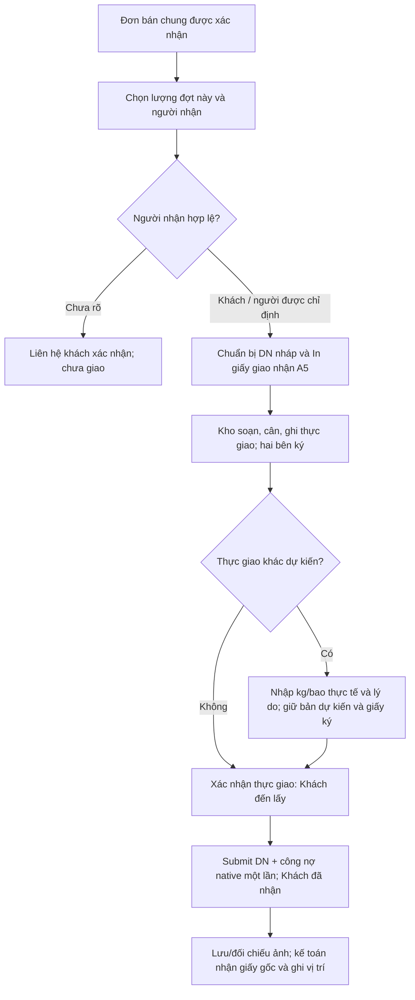
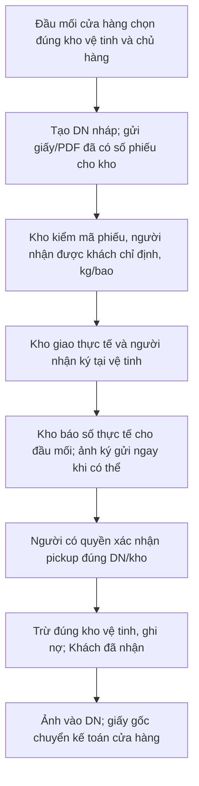
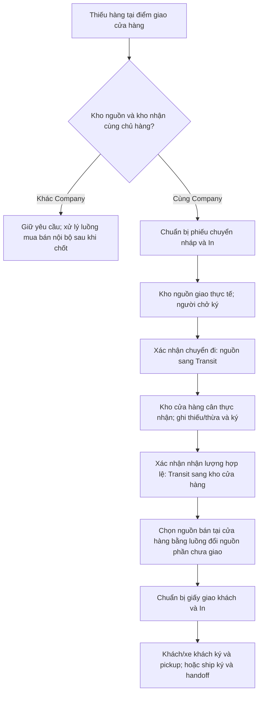
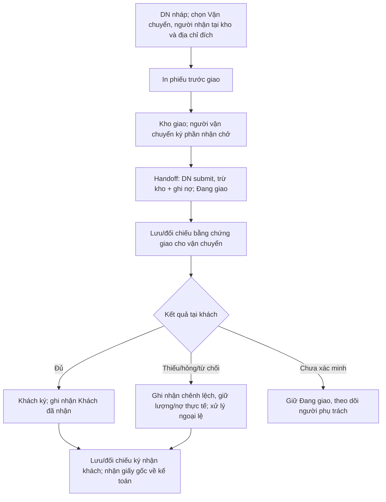
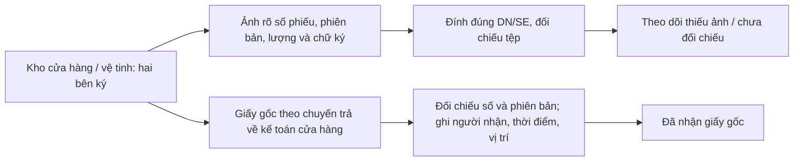

# Kho–giao nhận: quy trình ít bước trên nền0.16.4

> Bổ sung21/10/2026: xem [đối chiếu pháp lý và bộ chứng từ đề xuất](de-xuat-chung-tu-kho-theo-phap-ly-20261021.md). NĐ254/2026 và TT91/2026 có hiệu lực01/07/2026 đã thay căn cứ hóa đơn cũ; không dùng NĐ123/2020,NĐ70/2025,TT32/2025 như căn cứ hiện hành cho giao dịch mới. Mẫu ghép/nhân sự/luồngMISA cần đối chiếu như tài liệu bổ sung; chưa thay mẫu production hoặc coi quy chế này đã ban hành.

**Cập nhật sau phản hồi chủ dự án21/10/2026:** đọc ưu tiên `bo-sung-kho-mat-mang-thu-tien-doi-soat-20261021.md`. Cho phép người phụ trách được giao quyền lập giấy tay mới và giao khi mất mạng, không giữ khách chờ ERP; bắt buộc phiếu thu khi thực thu và biên bản ký khi tăng/giảm nợ. Một bản nợ chi tiết từng đơn vị/cọc/tiền chưa phân bổ; lái xe chỉ ký nợ khi có quyền riêng. Các sơ đồ dưới là khung ban đầu, phải bổ sung nhánh giấy dự phòng và bộ giấy theo tài liệu cập nhật, không dùng để bắt xe chờ xác nhận online.

Ngày21/10/2026. **Thiết kế và đối chiếu nguồn; chưa triển khai thay đổi này vào ERPNext.** Production0.16.4 đã ĐẠT theo log người vận hành; người dùng xác nhận địa chỉ đầu đơn đã hiển thị đúng. Chưa suy xác nhận đó thành đã thử thêm/sửa SĐT thật hoặc nghiệm thu toàn bộ kho.

## 1. Mục tiêu, phạm vi và quyết định đã chốt

90% đơn là khách hoặc lái xe của khách đến lấy,10% gửi ship (tỷ lệ chủ dự án cung cấp, không phải đo từ DB). Tối ưu nhánh tự lấy trước; Nhà máy vẫn là phân hệ riêng. Một đơn bán chung; hệ thống giữ chứng từ gốc theo đơn vị sở hữu/kho. Không thêm màn điều phối, bảng nhiệm vụ hoặc sổ tồn/công nợ thứ hai.

**Chủ dự án xác nhận21/10/2026:**
- Lái xe do khách chỉ định/xác nhận ký nhận đủ tại kho được tính là khách đã nhận. Lưu căn cứ xác nhận người nhận; không mặc nhiên coi mọi người xưng là lái xe của khách đều hợp lệ.
- Giấy gốc có chữ ký lưu tập trung ở kế toán cửa hàng; kho vệ tinh chuyển giấy về. Có ảnh chưa đồng nghĩa đã nhận giấy gốc.
- Địa chỉ đầu đơn sau nâng0.16.4 đã kiểm đạt. Nghiệm thu toàn bộ bằng nhân sự/hàng/tồn/máy in thật vẫn gom cuối khi dữ liệu đủ.

Đề xuất thao tác bình thường: **Chuẩn bị giao & In → người giao/nhận kiểm và ký → Xác nhận thực giao**. Hai thao tác phần mềm có ý nghĩa nghiệp vụ, không thêm lượt duyệt cho mọi phiếu. Đối chiếu ảnh và gom giấy là việc sau giao, không bắt khách đứng chờ. Có thể một người dùng ERP thực hiện cả chuẩn bị và xác nhận nếu đã được cấp đủ quyền phù hợp và kiểm thực tế; không tự cấp/gộp quyền trong bản thiết kế này.

Phạm vi đầu: giao trực tiếp cửa hàng/vệ tinh, gom cùng đơn vị về cửa hàng, nhiều điểm giao/từng phần, gửi ship; bản in trước giao và bằng chứng/gốc. Ngoài phạm vi: đổi chủ hàng giữa các Company, giữ tồn vật lý ngay khi in, QR/offline tự đồng bộ, hóa đơn MISA một phần, lệnh/mẻ sản xuất, đổi mẫu pháp định hoặc tự quyết thời hạn lưu theo luật. Các việc này không được lồng vào để làm gọn nút. Riêng giấy dự phòng và nhập bù khi mất mạng đã được mở rộng theo phản hồi sau, xem tài liệu bổ sung; không đồng nghĩa duyệt QR/SPA/offline tự đồng bộ.

## 2. Hiện trạng đã kiểm từ code0.16.4

| Nguồn | Đã có | Khoảng trống cần xử lý |
|---|---|---|
| `kh_aph/ban_nhanh.py`: preview, create_drafts, create_and_dispatch, print_note/print_batch | Lập DN nháp theo `(Sales Order nguồn, kho)`; giữ mã lượt/nội dung; nháp đã in được; xuất ngay chỉ khi có quyền; retry và transaction nhóm | Không được nói phiếu chờ xuất không in được. Cần một lối thao tác dễ thấy, giữ chuẩn bị/in tách khỏi xác nhận thực giao |
| `kh_aph/templates/ban_nhanh/phieu_dot_xuat.html` | A5 ngang hai liên Lưu kho/Giao nhận, có giá bán, năm ô ký; nháp có cột yêu cầu và cột thực xuất trống | Chưa phải mẫu giao nhận tối giản đã duyệt. Bản sau submit luôn ghi BẢN SAO nên chưa phân biệt bản đầu in sau ghi nhận và in lại. Không xóa mẫu này vì đã theo mẫu chủ dự án |
| `delivery_note.js`, `ban_014.js`, `ux_delivery_layout.js` | In A5, phiếu chuẩn, biên bản; xác nhận pickup/handoff/receive, hồ sơ ký; đã gom một phần nhãn | Nhiều mục In vẫn có mục đích khác nhau, phải gom lựa chọn theo tình huống; giữ mẫu chuẩn ở Tra cứu/In khác |
| `kh_aph/delivery_status.py`: confirm | pickup: DN nháp → đã submit/Khách đã nhận; handoff: nháp → đã submit/Đang giao; receive chỉ đổi dấu nhận sau xuất | Giữ ba trạng thái. Cần làm rõ lái xe khách được chỉ định thuộc pickup; ship do bên bán bố trí thuộc handoff |
| `kh_aph/delivery_receivable.py`: post_receivable | DN submit gọi SI native, update_stock=0, không ghi kho hai lần | Không viết lại tài chính; nhấn in/đối chiếu/gom giấy không gọi service này |
| `delivery_info.py`, `ho_so_giao_nhan.py`, `delivery_issue.py` | Người thực giao/nhận, actor/time; tệp riêng đúng DN, kiểm phiên sửa, thay tệp mất đối chiếu; ngoại lệ có phụ trách/căn cứ | Bản ký chỉ lưu trên DN đã xuất; đối chiếu chỉ khi Khách đã nhận. Chưa có dấu nhận/vị trí giấy gốc; chưa đối chiếu riêng ký giao cho ship khi còn Đang giao |
| `kh_aph/delivery_slip.py`: deliveries/consolidated | Phiếu tổng hợp chỉ lấy DN đã submit, không thay chứng từ từng đơn vị | Không dùng để in chuẩn bị giao trước xuất. Không nới lọc docstatus rồi gọi như chứng từ gốc đã giao |
| `kh_aph/factory_transfer.py`: send/receive, `public/js/factory_transfer.js` | Chuyển cùng đơn vị qua Transit, nhận từng phần, khóa nguồn/chống trùng. Code dùng Stock Entry và quyền kho, không phải sổ riêng của nhà máy | send hiện tạo+xác nhận sau câu hỏi hàng đã lên xe rồi mới mở SE; cần nhánh chuẩn bị nháp/in trước khi xe đi. Tái dùng logic và giữ màn Nhà máy riêng; không đưa mọi người vào Nhà máy để chuyển hàng cửa hàng. Khi nhận, code đang đối chiếu bao theo Item hiện tại: cần kiểm hồi quy quy cách thay đổi trong lúc hàng đi đường, giữ snapshot phiếu nguồn |
| `kho_chuan.py`, `apps/lab9x/lab9x/cay_kho.py` | Loại kho, scope Company, cấm nhiều loại không bán | `KHONG_BAN` chưa gồm Vận chuyển, validate_kho_ban chỉ xét danh sách đó; hồ sơ cũ đã nêu từng chọn kho Transit trên đơn. Đây là khoảng trống đọc từ nguồn, chưa chạy ca tái hiện trên production. Cần kiểm và chặn nhất quán ở server/UI cho luồng bán, không chỉ ẩn gợi ý |
| `docs/de-xuat-mau-3-lien/` | Hai bản chụp nháp chuyển kho và giao vận chuyển | Chưa duyệt, không phải template đang chạy; không khôi phục chữ ký/chân trang đã bỏ trong nháp hoặc tự áp3liên |

Bằng chứng kiểm kỹ thuật0.16.4 và image nằm trong `ban-giao.md`, `deploy/release/TRANG_THAI.md`. Bản đối chiếu này đọc nguồn; không giả là đã chạy các flow mới bên dưới trên site thật.

## 3. Quy trình và số người tham gia

### 3.1 Khách hoặc lái xe khách đến lấy tại cửa hàng — ưu tiên chính

Người dùng phần mềm: một người đủ quyền có thể làm cả D và H; nếu bán hàng/kho phân công khác nhau thì hai tài khoản, không thêm cấp duyệt. Người thực giao và người nhận ký: hai bên thực tế. Tổng số người khác nhau thường2–3 khi một người dùng ERP kiêm người giao; nếu người bán và kế toán kho đều riêng với nhân viên kho thì có thể4. Đây là cách bố trí, không ép số người cố định hoặc gộp quyền mặc nhiên.

Đơn thường không cần in đơn bán thêm: số DBC và các DN xuất hiện trên giấy giao nhận. Chỉ in đơn/báo giá khi khách yêu cầu. Tự lấy xong không bấm thêm Khách đã nhận; pickup đã làm việc đó.

`create_and_dispatch` hiện có chỉ dùng khi hàng đã thực giao, không dùng để trừ tồn sớm nhằm có giấy đem đi ký. Mất phản hồi ghi thành công thì mở lại kết quả cũ; lỗi mở cửa sổ/máy in không phải lý do tạo phiếu xuất lần nữa.

### 3.2 Khách hoặc lái xe khách lấy trực tiếp tại kho vệ tinh

Không chuyển tồn giả qua cửa hàng nếu khách lấy trực tiếp ở vệ tinh. Một đầu mối ERP + người thực giao ở vệ tinh + người nhận (thường3 người); người kho không cần tài khoản. Đầu mối xác nhận dựa trên thông tin thực giao có người báo/thời điểm; không tự động xác nhận từ việc gửi PDF hoặc nhận ảnh.

Không bắt có ảnh ngay mới ghi xuất vì quy tắc hiện hành không bắt attachment để giao. Chưa có ảnh thì đưa việc thiếu bản ký vào hàng chờ; chưa liên hệ xác minh được thực giao thì chưa ghi nhận đã xác minh trên ERP. Khi mất mạng có thể dùng giấy dự phòng có số, kể cả lượt mới theo quyết định của người được giao quyền; đầu mối ghi ERP sau, không bắt kho giữ khách chờ. Đã bổ sung nhánh giấy tay mới do người phụ trách được giao quyền quyết định tại tài liệu cập nhật; không bắt khách chờ ERP khi mất mạng.

### 3.3 Gom kho vệ tinh về cửa hàng, rồi khách lấy/gửi ship

Chuyển đi/nhận nội bộ không tạo SI hoặc nợ khách. Hàng đang trên đường không phải tồn khả dụng cửa hàng. Đơn ban đầu chọn kho vệ tinh: chỉ đổi nguồn phần chưa giao sau khi hàng về kho cửa hàng; không sửa dòng đã giao và không tạo DN nháp ở cả hai kho cho cùng lượng. Nếu đã có DN chờ tại vệ tinh thì xử lý nháp/giữ chỗ đó trước, không giữ hai lượt song song.

Nhiều vệ tinh → cửa hàng: từng chuyến/chủ hàng giữ SE và lượng riêng, nhận từng phần; chỉ lượng thực đã về mới giao tiếp. Cùng một địa điểm nhưng khác Company vẫn là các kho theo chủ hàng. Không chọn kho cửa hàng của công ty khác chỉ vì cùng địa chỉ vật lý.

Một đầu mối ERP có đủ quyền hai kho có thể chuẩn bị/xác nhận các bước; hai người kho ở hai đầu và người chở tham gia giao nhận thực tế. Người chở có thể kiêm một bên nếu đúng thực tế, ghi vai trò thật. Khi khác phạm vi quyền thì hai đầu mối ERP; không bỏ xác nhận đầu nhận để giảm một người. Không bắt tạo Material Request nếu đã có nhu cầu cụ thể và người thao tác đủ quyền; giữ Material Request cho đề nghị bổ sung/chờ xử lý vốn có.

### 3.4 Gửi ship hoặc nhà xe do bên bán bố trí

Chữ ký nhận chở không phải chữ ký khách đã nhận. Receive sau handoff không xuất kho/ghi nợ lần nữa. Khi chỉ biết giao thiếu nhưng chưa xác nhận khách đã nhận phần nào, giữ trạng thái hiện tại và mở ngoại lệ; không tự đổi receive để đủ điều kiện đối chiếu. Nếu đã có xác nhận khách thực nhận phần hàng thì có thể ghi nhận mốc nhận, đồng thời giữ hồ sơ chênh lệch mở.

Người tham gia: người dùng ERP (một hoặc hai theo phân quyền), người kho thực giao, người vận chuyển, người nhận tại khách; không thêm người duyệt cho lượt bình thường. Giữ riêng công việc thu hộ/thu tiền theo luồng tiền đã có, không dùng chữ ký vận chuyển để tự ghi thu khách hoặc chốt bàn giao quỹ.

## 4. Quy tắc và ngoại lệ bắt buộc

| Tình huống | Cách xử lý và giới hạn |
|---|---|
| Giao một phần; nhiều điểm nhận | DN riêng cho lượng từng lượt/điểm; không vượt còn lại sau phiếu đã xuất + nháp hợp lệ; hiển thị đã giao/đang chuẩn bị/còn lập |
| Nhiều kho hoặc đơn vị | Một thao tác chọn có thể tạo nhiều DN nhưng giữ nhóm native `(SO,kho)`, không trộn chủ hàng. Lỗi nhóm sau rollback toàn lượt ghi; giấy chỉ cấp sau DB thành công |
| Sửa trước soạn/giao | Sửa nháp có quyền; bản in dự kiến cũ bị đánh dấu hết hiệu lực, cấp phiên bản mới khi thay nội dung chuẩn bị; không đổi âm thầm giấy đang dùng |
| Cân thực tế khác dự kiến | Bản giấy có cột dự kiến và cột thực giao để ghi thực tế, người giao/nhận ký xác nhận sửa. Một thao tác nhập thực kg/bao, lý do và xác nhận; DN qty ghi đúng thực xuất, snapshot dự kiến/phiên bản giấy ban đầu giữ nguyên. Không tạo bảng tồn dự kiến mới |
| Mã hàng/kho/chủ hàng sai | Không sửa tay trên giấy để hợp thức hóa. Dừng giao, đổi nguồn phần chưa giao đúng luồng, cấp lại giấy; vượt quyền chuyển người có quyền xử lý |
| Khách đổi người/lái xe trước xuất | Khách xác nhận người thay, cập nhật có quyền, vô hiệu giấy cũ; không tự coi trùng tên là cùng người. Lưu căn cứ liên hệ trong hồ sơ |
| Đã xuất muốn đổi địa chỉ/người nhận | Dùng endpoint điều chỉnh có lý do/lịch sử hiện có; không save/import đè. Không áp thông tin master mới lên chứng từ cũ |
| Chưa thực giao, không đến lấy và hủy lượt còn nháp | Hủy/bỏ nháp theo quy tắc native và trả lượng còn được lập; đánh dấu giấy cũ không còn hiệu lực; không tạo xuất/thu để rồi hoàn |
| Hủy sau xuất/thu | Kiểm native liên kết, quyền và chứng từ tài chính. Đã có thu/cọc phải xử lý độc lập theo luồng tiền; không xóa DN hoặc restore DB để hủy một giao dịch |
| Gửi ship thất bại, hàng quay lại | Nhập lại chỉ khi hàng thực về kho, dùng DN trả native đúng nguồn (có thể kho khác cùng Company theo luồng đang có); liên kết xử lý nợ đúng chứng từ, không nhập tồn giả lúc chỉ mới báo sẽ quay về |
| Mất/thiếu trên đường | Không mặc nhiên tạo phiếu trả. Ghi ngoại lệ có người phụ trách; dùng kiểm kê/hao hụt/giảm nợ theo chứng từ thích hợp và thẩm quyền đã chốt |
| Chuyển nội bộ nhận thiếu | Nhận đúng phần về, phần thiếu còn Transit để xử lý; không tự chi phí hóa hoặc kết thúc chuyến đủ. Nhận thừa bị chặn, xử lý riêng có căn cứ |
| Khách lấy thẳng tại vệ tinh khi chuyến gom chưa đi | Sửa/hủy nháp chuyển có quyền rồi chuẩn bị DN tại kho nguồn; tránh giữ hai nháp cho một lượng |
| Khách đổi sang lấy ở vệ tinh sau khi đã chuyển đi | Không xuất trực tiếp từ kho vệ tinh đã giảm tồn; kiểm thực tế vị trí hàng, chờ nhận hoặc luồng đổi điểm có chứng từ phù hợp |
| Mất mạng/in lỗi/bấm lặp | Giữ token/nội dung, khóa và kiểm phiên; trả kết quả cũ. In lại không tạo DN/SE/SI/GL/SLE/PLE mới |
| Có ảnh nhưng thiếu/chưa rõ giấy gốc | Theo dõi độc lập. Không đánh dấu đã nhận gốc chỉ từ ảnh; không tự đưa đơn sang chưa giao chỉ vì thiếu hồ sơ |
| In trước giao không giữ tồn vật lý | Tiếp tục kiểm tồn tại lúc submit; không cam kết giữ tồn từ nháp/in. Hai đơn tranh cùng tồn phải bị kiểm ở ghi xuất, có thông báo và không để sổ dở |
| Kho Transit/dở dang/cách ly | Chặn bán từ kho không được bán ở cả chọn nguồn/đổi nguồn/tạo DN/ghi xuất. Quy tắc phải xét loại kho và warehouse_type, không so chuỗi tên riêng |

## 5. Dữ liệu, trạng thái và hợp đồng thao tác đề xuất

Giữ `docstatus` native và ba trạng thái giao hàng hiện có. Trạng thái bản ký, nhận giấy gốc, chuyến nội bộ là các chiều riêng; không thêm một trạng thái tổng kiểu Hoàn tất trộn cả bốn chiều.

**Dữ liệu hiện có tái dùng:** DN customer/company/items/qty/warehouse, `kh_aph_bags`, snapshot kg/bao, các trường `delivery_info`, trạng thái actor/time, file/ghi chú/dấu đối chiếu `ho_so_giao_nhan`, hồ sơ `delivery_issue`; SE source/destination/transit/outgoing_stock_entry/ste_detail và dấu nhận chuyến. Thông tin khách hiện tại0.16.4 chỉ hỗ trợ chọn đúng người, không tự sửa snapshot địa chỉ phiếu cũ.

**Blueprint đề xuất, chưa có trong schema:** tên dưới là phương án cần kiểm metadata/conflict khi build; không coi là field đã cài.

| Parent / field đề xuất | Loại, nguồn | Khi nào hiện/được sửa | Ràng buộc |
|---|---|---|---|
| DN/SE `kh_aph_print_revisions` | Table / child `Kh Delivery Print Revision` mới | Thu gọn Lịch sử bản in; chỉ service được thêm | Child không có lifecycle/sổ kho riêng, không là bảng nhiệm vụ |
| Child `revision`, `snapshot_json`, `fingerprint`, `template_key`, `file` | Int, Code(JSON allowlist), Data, Data, Link File | Server cấp khi chuẩn bị bản in | Bất biến; PDF/snapshot riêng tư đúng parent, không giá vốn; cấp bản không đồng nghĩa máy đã in vật lý |
| Child `issued_by`, `issued_at` | Link User, Datetime | Server từ phiên hiện tại | Không nhận actor/time từ client; không sửa/xóa lịch sử qua save/import |
| DN `kh_aph_carrier_proof` | Attach riêng tư | Chỉ nhánh Vận chuyển sau handoff | Phải đúng DN; không ghi đè bản ký khách `kh_aph_ban_ky` |
| DN `kh_aph_carrier_checked_by`, `kh_aph_carrier_checked_at` | Link User, Datetime | Server khi đối chiếu giao người chở | Không đổi trạng thái Khách đã nhận; thay tệp/ghi chú mất dấu cũ |
| DN/SE `kh_aph_paper_received_by`, `kh_aph_paper_received_at`, `kh_aph_paper_location` | Link User, Datetime, Data | Hồ sơ giấy; người nhận gốc nhập vị trí, server đóng dấu | Dấu trống = chưa nhận gốc; vị trí bắt buộc khi xác nhận; sửa/gỡ có lý do/lịch sử |
| DN `kh_aph_recipient_basis` | Small Text | Khi người được khách cử nhận | Căn cứ khách xác nhận + kênh/thời điểm; không bắt sao chụp giấy tờ tùy thân; không tạo Customer/Contact trùng |
| SE Detail `kh_aph_planned_destination` | Link Warehouse | Chỉ chuẩn bị chuyển qua Transit | Kho đích dự kiến cùng Company; không thay t_warehouse thực ghi sổ (Transit). Preview nhận gợi ý đúng đích |
| SE `kh_aph_related_shared_order` | Link / APH Shared Sales Order, tùy chọn | Khi chuyến gom phục vụ một đơn cụ thể | Chỉ truy nguyên nhu cầu, không giữ lượng/giảm còn giao trên đơn và không tự đổi nguồn. Chuyến chung nhiều đơn không ép gán giả một đơn |

Ảnh chụp giấy đã ký lưu File riêng tư. DN dùng file/dấu đối chiếu hiện có; SE cần trường tệp ký + ghi chú + dấu đối chiếu tương ứng trước khi có thể nhận giấy gốc đầy đủ. Khi build đặt tên theo nhóm `kh_aph_transfer_proof_*`, kiểm quyền theo SE; không tái dùng trường DN bằng một URL công khai. Giữ Comment/Version trước–sau và chặn sửa blob/xóa tham chiếu đang dùng như cơ chế DN hiện có.

**Hợp đồng service (tên phương án, chưa triển khai):**
- `prepare_delivery`: một thao tác UI gồm request create_drafts hiện có (toàn bộ nhóm DN thành công/rollback cùng nhau), sau đó request POST cấp bản in gắn DN đã lưu. Kiểm read/create/write/print + Company/Warehouse/Customer, token/nội dung và phiên; không submit, không SI, không tự commit giữa chừng trong service. Nếu request cấp PDF thất bại sau khi tạo DN đã thành công, phải báo DN đã có nhưng chưa cấp được bản in; lần thử lại chỉ mở/cấp đúng DN. Cấp lại cùng snapshot/template trả phiên bản cũ; đổi nội dung hợp lệ mới cấp phiên bản mới. File hệ thống và máy in không được hoàn tác bằng rollback DB: quản lý tệp tạm/lỗi, chỉ dọn tệp mới chưa có tham chiếu, giữ mọi giấy/bản ký lịch sử; không hứa rollback giấy đã gửi.
- `confirm_actual`: nhận DN + modified + revision + dòng thực kg/bao + người giao + loại pickup/handoff + mã thao tác. Khóa DN/nguồn, kiểm quyền, lượng còn lại, snapshot giấy và duyệt giá/hạn mức hiện tại. Điều chỉnh thực lượng trên nháp có lịch sử, rồi gọi confirm hiện có trong một transaction; thất bại không để đổi qty một nửa. Retry cùng nội dung trả kết quả cũ; khác nội dung với token cũ bị chặn. Đường native submit cũng phải giữ các guard, không chỉ kiểm Dialog.
- Phân biệt **đổi kế hoạch chuẩn bị** (giấy cũ hết hiệu lực, cấp revision mới) với **điền cột thực giao trên giấy đã cấp** (giữ revision dự kiến và lưu thực lượng/bằng chứng). Không yêu cầu in lại chỉ vì chênh cân nhỏ đã được hai bên ghi rõ và ký; giới hạn lượng/bao vẫn kiểm server, không tự đặt dung sai.
- `prepare_transfer`: thêm nhánh tạo SE chuyển NHÁP/cấp giấy trước xe đi, dùng lại kiểm Company/kho/kg/bao của send; `confirm_transfer` xác nhận đúng SE đã chuẩn bị. Dùng chung mã lượt theo source, không sinh một SE mới khi chuyển từ prepare sang confirm hoặc mất phản hồi. Lối send đang có giữ tương thích, chỉ dùng khi đã thực giao.
- `receive_transfer`: tái dùng receive/khóa nguồn/remaining_rows; không ép nhận đủ chuyến hoặc ép qty theo giấy dự kiến. Cần kiểm scope kho đích và expected_modified; đích thay khác dự kiến có lý do, cùng Company.
- `review_proof`/`receive_paper`: chỉ thay hồ sơ có phiên sửa/actor/time/lý do, không gọi submit/receive khách hoặc phát sinh sổ. Riêng carrier review cho phép khi Đang giao; customer proof review tiếp tục đúng điều kiện nhận hàng.
- GET in lại vẫn chỉ đọc snapshot đã cấp theo quyền hiện tại; cấp phiên bản mới là POST có ghi hồ sơ. Không dùng GET để lén tạo phiên bản/tệp hoặc xác nhận xuất.

## 6. Phân quyền, giấy in và lưu trữ

### 6.1 Vai trò và kiểm soát

| Vai trò thực tế | Việc bình thường | Giới hạn |
|---|---|---|
| Kế toán bán hàng | Chọn đúng khách/mã–tên hàng, lập đơn/lượt, cấp bản in, liên hệ xác minh người nhận | Không tự có quyền submit DN chỉ vì thấy nút chuẩn bị; không chỉnh giá vốn |
| Người được phân quyền xác nhận kho | Kiểm thực tế, nhập thực lượng, xác nhận DN/SE đúng kho; lưu/đối chiếu bằng chứng | Native create/write/submit/print và Company/Warehouse/Customer đều kiểm ở server; không tài khoản dùng chung |
| Nhân viên kho không có tài khoản | Soạn/cân/giao, ký và báo kết quả, chuyển ảnh/giấy | Không tự tạo actor phần mềm; tên người thực giao khác user xác nhận được lưu riêng |
| Kế toán cửa hàng nhận giấy gốc | Nhận tập giấy, đối chiếu số/phiên bản/chữ ký/ảnh, ghi vị trí lưu | Không cần xác nhận xuất lần hai; chỉ ghi nhận giấy khi thực có trong tay |
| Kế toán trưởng/người có thẩm quyền | Duyệt giá/rủi ro/ngoại lệ theo cơ chế đã có, xử lý thiếu/thừa/hủy/đổi nguồn vượt quyền | Không thêm chữ ký ERP cho mọi lượt bình thường. Có role trưởng vẫn không vượt scope native |
| Khách/lái xe/ship | Kiểm và ký đúng vai trò thực nhận | Người chở của bên bán không ký thay khách. Khách chỉ định lái xe là căn cứ pickup đã chốt |

A5 hiện có ghi giá bán thuần chưa thuế; biên bản chuẩn khi được phép hiện giá dùng bộ tính giá gồm thuế riêng. Không trộn tổng tiền/đổi cách tính chỉ vì gom lối In. Nhân sự hạn chế giá chỉ dùng giấy số lượng qua renderer được phép. A5 có giá bán giữ đúng quyền đang có; không mở giá bán/giá vốn chỉ vì gom đường in. File/preview/PDF/export đều kiểm parent và scope tại lúc đọc, kể cả quyền bị thu hồi sau tạo. Không gửi gói ảnh/PDF nhiều Company cho người chỉ có quyền một phần.

### 6.2 Bộ mẫu và số liên đề xuất

| Mẫu | Dùng khi nào | Liên/chữ ký đề xuất | Hiện trạng |
|---|---|---|---|
| A5 xuất kho theo mẫu chủ dự án | Khi cần mẫu có giá bán/ô kế toán | Giữ2liên và các ô hiện có; không tự cắt ô ký của mẫu chuẩn | Đã có, giữ làm lựa chọn In khác |
| Phiếu giao nhận tại kho A5, không giá | Khách hoặc người khách cử lấy tại cửa hàng/vệ tinh | Đề xuất2liên: kế toán lưu gốc, người nhận giữ; ký người thực giao + người thực nhận, người lập ghi tên/giờ từ hệ thống | **Mẫu vận hành mới đề xuất**, chưa là mẫu đã duyệt; có thể dùng A5/biên bản hiện có trong lúc chốt |
| Phiếu giao vận chuyển | Nhận chở ở kho, nhận tại khách là hai mốc | Đề xuất3liên: kế toán/khách/đơn vị vận chuyển; ô ký tách người giao–người chở–người nhận cuối | Nháp3liên chưa duyệt; phải chốt cơ chế lấy lại liên ký khách, không coi3liên tự giải quyết được chứng minh nhận cuối |
| Phiếu chuyển kho kiêm giao nhận nội bộ | Vệ tinh → cửa hàng cùng Company | Đề xuất3liên: nguồn/đích/chuyến; có kg/bao giao và nhận, chữ ký hai đầu/người chở. Liên chứng minh hai đầu về kế toán, nguồn/đích giữ bản còn lại/ảnh | Nháp chưa duyệt; không áp mới chỉ từ tài liệu này |
| Đơn bán/bảng kê tổng hợp | Khách yêu cầu hoặc nhiều DN cần tra cứu | Tùy chọn; ghi rõ tham chiếu từng DN/chủ hàng/phiên bản | Không mặc định in thêm và không thay chứng từ từng đơn vị |

Mẫu giao nhận vận hành hai bên ký không thay yêu cầu chữ ký/chứng từ kế toán hoặc hóa đơn của từng đơn vị. Không kết luận mẫu mới là mẫu pháp định theo thông tư mới chỉ vì in từ ERP. Kế toán xác định bộ chứng từ và thời hạn lưu theo chính sách áp dụng; bản này không tự đặt số năm lưu.

Nhiều DN ⇒ số giấy tăng theo số DN thực tế `(SO,kho)`; không hứa một phiếu duy nhất cho nhiều Company. Một cửa sổ có thể in cả tập, nhưng tách số/đơn vị. Nếu muốn một bảng nhận chung có một chữ ký phủ nhiều DN thì phải chốt nội dung/phạm vi người xem và liên kết chứng cứ riêng, chưa làm trong bản đầu.

### 6.3 Đường đi giấy gốc

Đề xuất vị trí: `đơn vị / tháng / tập / khoảng số phiếu` và số trang khi cần; không lấy một mã tủ chung thay khả năng tìm tờ. Phân loại riêng bản khách ký, bản người vận chuyển ký và chuyển nội bộ. Giữ bản gốc có sửa tay kèm chữ ký xác nhận thực lượng, không thay bằng tờ in lại sạch. Ảnh mới không xóa phiên bản cũ; đánh dấu bản hiện hành và lý do thay.

Việc tồn trong Kho vận: Chờ xuất; Đang giao; Chuyến đang trên đường; Thiếu bản ký; Có tệp chưa đối chiếu; Chưa nhận giấy gốc; Chênh lệch cần xử lý. Đây là filter trên DN/SE/hồ sơ nguồn, không phải7màn mới. Hiển thị thu gọn theo vai trò, chỉ hiện số cần xử lý; các trạng thái hồ sơ có thể đồng thời cùng tồn tại. Gợi ý gom ảnh cuối lượt/ca, giấy gốc theo chuyến về cửa hàng; thời hạn cụ thể chưa chốt, không tự đặt SLA cứng hoặc dùng thiếu giấy chặn bán bình thường.

## 7. Tác động hệ thống và bất biến

| Thao tác | Kho/giá vốn | Nợ/doanh thu/tiền/MISA |
|---|---|---|
| Lập đơn, tạo DN/SE nháp, cấp/in giấy | Không ghi xuất/nhập; không thêm giữ tồn vật lý | Không tự thu/cấn cọc/ghi nợ; MISA giữ luồng riêng |
| DN pickup/handoff thực giao | DN native ghi SLE/giá vốn theo cơ chế đã có một lần | SI native update_stock=0 theo delivery_receivable; không tự phân bổ cọc hoặc ghi thu |
| Nhận khách sau handoff | Không ghi kho thêm | Không ghi nợ/doanh thu/thu tiền thêm |
| SE chuyển đi/nhận nội bộ | Chuyển giá trị giữa nguồn–Transit–đích cùng Company theo native; nhận từng phần | Không nợ khách/không doanh thu/không thu chi khách; GL nếu native có theo tài khoản kho không được bỏ qua |
| Upload/đối chiếu ký/nhận giấy gốc/in lại | Không ghi tồn/giá vốn | Không ghi SI/GL/PLE/Payment Entry |
| Trả/hủy/giảm nợ/hao hụt | Chứng từ chuẩn có quyền, đúng hàng thực về/nguồn | Theo luồng ngoại lệ hiện có, không thao tác hồ sơ thay bút toán |

Không đổi cọc, thu hộ, kế hoạch phân bổ hoặc giả ngân hàng/company nhận tiền. Không đổi quy tắc sản xuất hay điểm ghi nợ. Loại kho Vận chuyển phục vụ chuyển nội bộ không phải trạng thái DN Đang giao; không trộn hai khái niệm này.

## 8. Bộ ca nghiệm thu có thể giao agent khác

Dùng site UAT tách biệt, dữ liệu giả. Fixture tối thiểu: khách C1/C2 trùng tên, người nhận R1/R2, đơn vị A/B, kho bán A1/A2/A3 và B1, Transit mỗi đơn vị; hàng X100kg/4bao tại A2, Y50kg/2bao tại A3; đơn C1 đặt X50kg+Y25kg, quy cách snapshot25kg/bao. Tạo mặt hàng kg lẻ riêng khi kiểm chênh cân lẻ, không tự bẻ snapshot để ghép các con số.

| Ca | Đầu vào/thao tác | Kết quả mong đợi |
|---|---|---|
| KV01 | Tạo lượt tự lấy25kg/1bao từ A2, chuẩn bị/in | Một DN nháp đúng SO/kho, giấy có số/phiên bản/dự kiến, actual trống; SLE/GL/SI/PLE không tăng |
| KV02 | Kho giao25kg, khách ký; người đủ quyền xác nhận pickup | DN submit/Khách đã nhận; đúng25kg/1bao, SLE/SI một lần; không cần receive nữa |
| KV03 | Xe khách có căn cứ được chỉ định ký tại A2 | Kết quả nhưKV02, lưu người/căn cứ; không tạo việc chờ nhận tại nhà khách |
| KV04 | Người lạ không có căn cứ hoặc chọn khách C2 | Chưa giao/chưa confirm; không làm mất lựa chọn đơn C1 hoặc tự gán người |
| KV05 | Chuẩn bị50kg/2bao, thực giao25kg/1bao có giấy ký rõ | DN thực25kg; snapshot chuẩn bị50kg giữ; còn đơn tính theo thực lượng, không ghi50kg hoặc tạo lần xuất thứ hai |
| KV06 | Thực giao vượt còn lại/không khớp kg–bao/số âm | Server từ chối, DN/sổ không đổi một nửa |
| KV07 | Hai lượt/phiên đồng thời cùng nguồn/cùng token, mất phản hồi sau commit | Một bộ DN/SI/SLE; trả mã cũ; khác nội dung cùng token bị từ chối |
| KV08 | Hai đơn cùng tranh tồn sau khi đã in | In không bảo đảm giữ tồn; submit vượt tồn bị chặn theo guard, không ghi âm/sổ dở để hợp giấy |
| KV09 | In lỗi, popup bị chặn, in lại sau submit | Mở lại đúng DN/phiên bản; không tăng đơn/phiếu/sổ; giấy không là lệnh lấy hàng lần hai |
| KV10 | Sửa kế hoạch/kho/người nhận sau cấp giấy | Giấy cũ hết hiệu lực, cấp phiên bản mới có audit; submit dùng bản cũ sai nguồn bị chặn |
| KV11 | Khách lấy trực tiếp ở vệ tinh, đầu mối ERP tại cửa hàng | Trừ A2 thực tế; không tạo SE/nhập A1 giả, lưu người thực giao khác user xác nhận |
| KV12 | Chọn Vận chuyển, người chở ký, handoff25kg | Đang giao; ghi kho/nợ một lần; chỉ có bằng chứng nhận chở chưa tự receive khách |
| KV13 | Đối chiếu ảnh người chở khi còn Đang giao | Được lưu/đối chiếu carrier riêng; không gán dấu customer proof hoặc đổi trạng thái giao |
| KV14 | Khách nhận và receive sauKV12 | Chỉ đổi mốc nhận; SLE/GL/SI/PLE không tăng |
| KV15 | Khách nhận thiếu hoặc từ chối, hàng chưa thực về | Hồ sơ chênh lệch mở; không tự nhập trả/giảm nợ/thu tiền; actor và người phụ trách đúng |
| KV16 | Trả về kho khác cùng Company có hàng thực về | Đúng DN trả native và căn cứ tài chính; không nhận vào Company khác hoặc giảm nợ hai lần |
| KV17 | Chuẩn bị chuyển A2→A1 qua Transit, in trước xe đi | SE nháp/cấp giấy, tồn nguồn/đích/Transit chưa đổi |
| KV18 | Xác nhận đi50kg/2bao | Một SE chuyển nguồn sang Transit; không SI/nợ khách; retry không thêm SE |
| KV19 | Nhận25kg/1bao từ chuyến50kg | A1 tăng25kg, Transit còn25kg; chưa giao từ A1 phần chưa về; không ép kết thúc chuyến |
| KV20 | Nhận tiếp25kg, nhận vượt hoặc nhận đồng thời | Tổng nhận không vượt50kg; vượt bị chặn, khóa đúng source row |
| KV21 | Gom A2+A3 về A1, cùng Company | Giữ chuyến/nguồn, đúng thực nhận từng hàng; chỉ một lần xuất bán sau gom; không trừ đồng thời vệ tinh và cửa hàng cho cùng giao khách |
| KV22 | Chuyển A2→B1 hoặc đổi Company đích lúc nhận | Bị chặn; không tự tạo mua bán nội bộ hoặc đổi chủ hàng |
| KV23 | Đơn chọn A2, đã có nháp DN rồi muốn gom A1 | Xử lý nháp cũ/đổi nguồn phần chưa giao đúng service, không giữ hai nháp cùng lượng |
| KV24 | Đổi nguồn sang Transit/warehouse_type Transit/dở dang/cách ly qua UI/API/native | Bị chặn ở server, không chỉ ẩn nút; phần hợp lệ kho bán/thành phẩm theo quy tắc cũ vẫn dùng được |
| KV25 | Nhóm nhiều kho/Company, nhóm sau lỗi giá/quyền/tồn | Không để DN/SE/SI/sổ dở hoặc xuất một phần ngoài ý người dùng; kết quả lỗi chỉ rõ nhóm |
| KV26 | Duyệt giá/rủi ro bị thu hồi sau in, đổi lượng/khách | Submit kiểm lại điều kiện hiện hành, không dùng giấy in như duyệt còn hiệu lực |
| KV27 | Bán hàng chỉ create/read/print, thiếu submit | Chuẩn bị/in trong quyền; không confirm, không nâng quyền bằng API trực tiếp |
| KV28 | Trưởng có role nhưng ngoài scope A2/B1; quyền bị thu hồi sau tạo | Không xem/in/đổi/submit tệp/phiếu ngoài scope; không lộ dữ liệu qua retry/snapshot |
| KV29 | Người hạn chế giá mở form/preview/PDF/File/export | Không thấy giá vốn; mẫu giá bán bị hạn chế vẫn chặn, mẫu lượng đúng quyền không bị phá |
| KV30 | Upload ảnh sai DN/SE, URL public, file ngoài hệ thống | Bị chặn, giữ bằng chứng/dấu cũ; snapshot chứa dữ liệu HTML được escape |
| KV31 | Thay tệp/ghi chú sau đối chiếu, xóa blob, save/import giả actor | Mất dấu hiện hành đúng loại hồ sơ, giữ lịch sử; blob đang dùng và dấu giả bị chặn |
| KV32 | Có ảnh ký nhưng chưa chuyển giấy gốc | Có tệp/đã đối chiếu vẫn có thể Chưa nhận giấy gốc; không giả đã nhận gốc |
| KV33 | Kế toán nhận giấy, nhập vị trí; retry, sửa/gỡ vị trí | Dấu server một lần, tìm được bản giấy; thay đổi có lý do/audit; không đổi kho/nợ |
| KV34 | Phiếu nguồn hủy, giấy cũ được mang đi lấy tiếp | Bản in/tra cứu có dấu hết hiệu lực; không được xuất lại từ giấy cũ, hủy native giữ phụ thuộc và lịch sử |
| KV35 | Data cũ trước nâng, cờ mới tắt | In/nhận/thu cũ hoạt động; không bắt bổ sung giấy/revision cho lịch sử, không backfill xác nhận giấy giả |
| KV36 | Cài lặp, nâng từ image0.16.4 và rollback | Schema/đếm/tổng/chi tiết/cờ khớp, dữ liệu và tệp được khôi phục đúng; không mất snapshot đã tạo |
| KV37 | Chuyến50kg/2bao snapshot25kg/bao đang đi, Item đổi thành20kg/bao | Nhận25kg/1bao theo snapshot chuyến được xử lý đúng; không ép theo Item mới hoặc nhận thừa/thiếu để khớp quy cách hiện tại |

Thực hiện Unit cho tính lượng/phiên bản/token; HTTP theo vai trò native và scope; Chrome thao tác in trước xuất/sửa thực lượng/mất phản hồi; PDF A5 đo tràn dòng/đa trang/bao–kg/chữ ký; so dấu vân trước–sau các thao tác hồ sơ. Dùng ca b014 hiện có làm hồi quy, không sửa assertion giảm kiểm để ra xanh. Nghiệm thu người thật/máy in và số bước đo sau, không suy tốc độ/hiệu quả từ sơ đồ.

## 9. Thứ tự triển khai, nâng cấp và khôi phục

1. **Chốt thiết kế hiện tại:** hai quyết định về lái xe khách và lưu gốc đã có ở mục1. Số liên/bố cục chữ ký cho mẫu mới, hạn chuyển giấy/ảnh và danh sách nhân sự thực tế vẫn là đề xuất; không ngầm coi được duyệt. Có thể triển khai phần độc lập đã rõ mà không đợi hàng/tồn thật.
2. **Lát A — đường tự lấy và giấy trước giao:** gom lối dùng DN nháp/In; xác nhận thực lượng một cửa; bản in/phiên bản; chặn Transit nhất quán; ghi căn cứ người nhận. Giữ A5 đã duyệt, tách bản vận hành không giá để duyệt bố cục, không xóa nút chuẩn trước khi có đường thay đã kiểm.
3. **Lát B — vệ tinh, gom và gửi ship:** chuẩn bị SE nháp trước xe đi, nhận qua Transit theo thực lượng, liên kết nguồn nhu cầu; bằng chứng nhận chở riêng. Tái dùng service phù hợp, không trộn màn Nhà máy vào bán hàng. Mỗi lát kiểm UAT tách biệt trước bật.
4. **Lát C — giấy gốc và công việc tồn:** nhận gốc/vị trí lưu, audit, filter đúng scope trên Kho vận, không thêm Workspace. Upload/đối chiếu có thể gom vào cùng hộp thao tác với confirm nhưng backend giữ tác động hồ sơ và ghi sổ phân biệt; lỗi tải file sau giao không báo giả thất bại xuất để người dùng gửi lại một lượt mới.
5. **Trước code mới:** chuyển mốc diễn tập Cổng3 từ0.16.3 sang production0.16.4/digest1a8f0063… và kiểm riêng; không coi PR hồ sơ production là đã làm việc này. Không tạo tag hoặc chốt version mới chỉ từ bản thiết kế.
6. **Đóng gói:** tính năng thêm cần cờ riêng mặc định tắt theo AGENTS, tên cờ/schema chốt khi build; đồng bộ FLAGS/quay-lui/dấu vân/preflight/workflow cho mọi cờ mới. Bộ cài rõ ràng/idempotent, không after_migrate, không thay core hoặc renameID. Existing bug guard Transit đánh giá hồi quy toàn bộ đường chọn kho, không tắt kiểm chỉ để giữ dữ liệu sai.
7. **Dữ liệu lịch sử:** không đánh dấu gốc đã về, tạo revision/PDF, chuyển trạng thái hoặc sửa qty cũ hàng loạt. Các dấu mới chỉ bắt buộc với lượt tạo sau khi bật cờ; phiếu cũ giữ đường tra cứu/in và service đã có.
8. **Trước production:** đủ bốn cổng đúng SHA, xem ảnh/PDF, diễn tập bản sao production có dữ liệu và tệp. Chủ dự án tự gắn tag; phát hành thành công, diễn tập đúng image/commit/khach.json/cờ rồi nâng trong tmux/bảo trì. Rollback=image0.16.4 + snapshot tương ứng trước nâng; sau có giao dịch mới phải xử lý phần phát sinh trước restore.

**Kết quả lượt này:** đã lập bản đối chiếu code và thiết kế thống nhất; chưa viết tính năng/đổi schema/quyền/mẫu in, chưa sửa site thật. Các điểm cần quyết định tiếp được tách khỏi phần tái dùng đã rõ, không yêu cầu duyệt lại nghiệp vụ đã chốt.
